# Vortrix Physics - Island Scalability

<strong>Task-Based Island Solver Under Non-Uniform Workloads</strong>

# Overview 
This document evaluates the multi-core scalability of the Vortrix Physics Engine island solver under different rigid body workload distributions. It covers solver speedup, worker workload distribution, load-balancing efficiency, and the effect of parallel execution on the physics simulation budget. 
Particular attention is given to large-island decomposition and its ability to expose additional parallel work when simulation islands contain substantially different amounts of solver work.
**PDF version:** [Performance & Scalability (Island Solver)](Vortrix%20Physics%20-%20Island%20Scalability.pdf)

## Benchmark Configuration
* **Experiment Date:** 01 October 2026
* **CPU:** AMD Ryzen 7 6800H (8 physical cores / 16 logical processors)
* **Worker threads Sweep:** 1 to 16 threads
* **Velocity iteration ($`N_{iter}`$):** 4, 8, 16 and 32
* **Simulation frequency:** 60Hz (16.6 ms sub-step budget).
* **Large Island decomposition threshold (N):** 8 constraints.
* **Constraint batch size (M):** 8 constraints
* **Compiler & Build:** Visual Studio 2026 (MSVC v14.50), C++ 17, Development configuration

## Test Setup
**Ragdoll:**
	180 independent ragdolls (~1,950 bodies, 1,769 constraints). 
	Many independent islands.

**Complex:**
	Multiple pendulums, box stacks, bridges, Jenga structure (~3,017 bodies, 145 global constraints).
	Fewer, larger, and more heterogeneous islands
The ragdoll scenario provides a workload with many independent islands, whereas the Complex scenario stresses large-island decomposition and workload distribution.

<table align = "center"> 
  <tr>
      <td>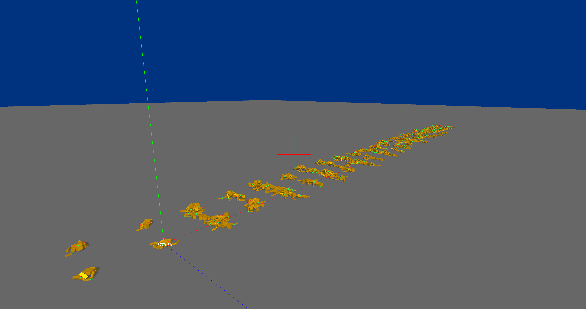</td>
	  <td>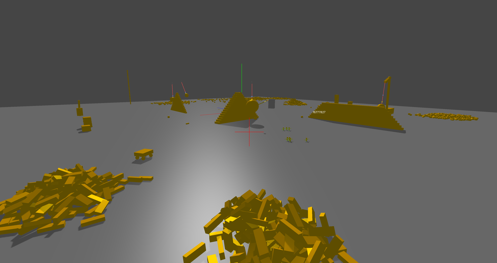</td>
  </tr>
  <tr>
     <th><i>Figure 1</i></th>
	 <th><i>Figure 2</i></th>
  </tr>
</table>

## Workload Measurement
Solver workload is measured by the number of Jacobian rows processed, not just the number of high-level constraints.
Internally, the solver decomposes active non-contact constraints into Linear1DRow primitives during preparation (see [ConstraintCoordinator::PrepConstraintSolving](../Vortrix/Dynamics/ConstraintCoordinator.cpp)). Measuring Jacobian rows provides a uniform unit of computational cost across heterogeneous constraint types and split batches. 
## Solver Scalability
Measured solver speedup is evaluated against two theoretical references: ideal linear scaling and an iteration-dependent theoretical speedup model.

Ideal linear scaling assume perfect parallel execution, where speedup increases proportionally with worker count. The iteration-dependent reference is calculated using: 

$`S(P,N_{iter})=(PN_{iter})/(P+N_{iter})`$

where $`P`$ represents the active worker count and $`N_{iter}`$ represents the number of velocity iterations. This model provides a theoretical reference for the relationship between parallism and iteration-dependent solver workload, illustrating diminishing returns as worker count increases relative to the available iteration-dependent parallelism.

<table align = "center"> 
  <tr>
      <td>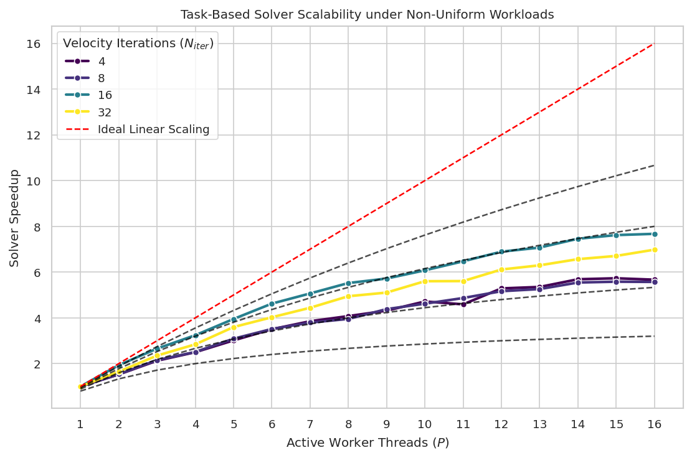</td>
  </tr>
  <tr>
     <th><i>Figure 3</i></th>
  </tr>
</table>

The 16-iteration configuration achieved the strongest scaling, reaching ~8x speedup at sixteen workers. 

While the 32-iteration run scaled consistently with worker count, its relative speedup remained slightly below the 16-iteration curve at higher thread counts due to increased batch-acquisition and coordination overhead. 

Shallow iteration (4- and 8-iteration) loops produced tightly grouped curves that plateaued earlier because the smaller total workload was exhausted before all worker threads could be fully utilised.

Hardware boundary across all configurations, scaling diverged from the ideal linear reference with a slight, noticeable gradient change around 8 workers, corresponding to the 8 physical cores of the AMD Ryzen 7 6800H.

## Worker Activity
<table align = "center"> 
  <tr>
      <td>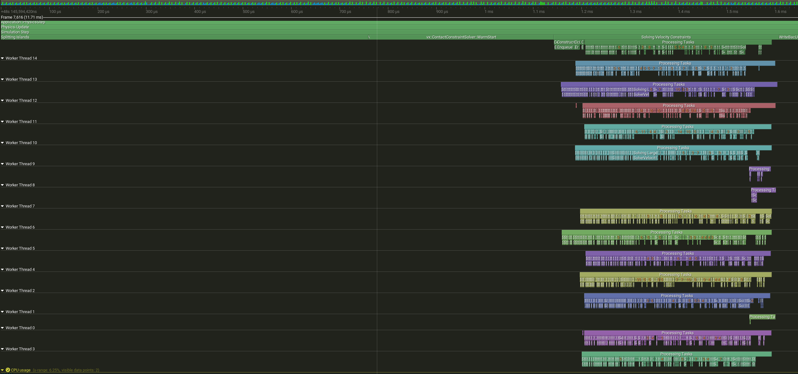</td>
	  <td>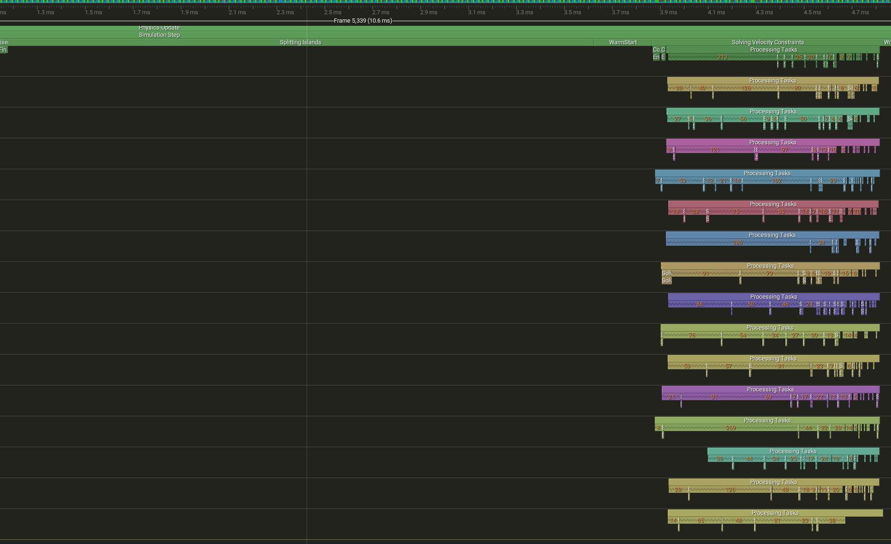</td>
  </tr>
  <tr>
     <th><i>Figure 4</i></th>
	 <th><i>Figure 5</i></th>
  </tr>
</table>

Tracy profiler captures were collected for the 4- and 16-iteration runs to inspect thread utilisation during the velocity solve:
* **4 Velocity Iterations:** Three of the 16 worker threads remained inactive through much of the island-solving window, only waking toward the end of the pass.
* **16 Velocity Iterations:** Only one worker experienced a brief initial delay before actively participating in batch solving. 

The traces highlight repeated transitions between single-threaded pipeline orchestration and multi-threaded solver execution. When no work is immediately available, workers sleep on the task coordinator’s conditional variable; therefore, worker count represents maximum concurrency rather than continuous 100% core saturation. 

## Physics Sub-Step Timing
<table align = "center"> 
  <tr>
      <td>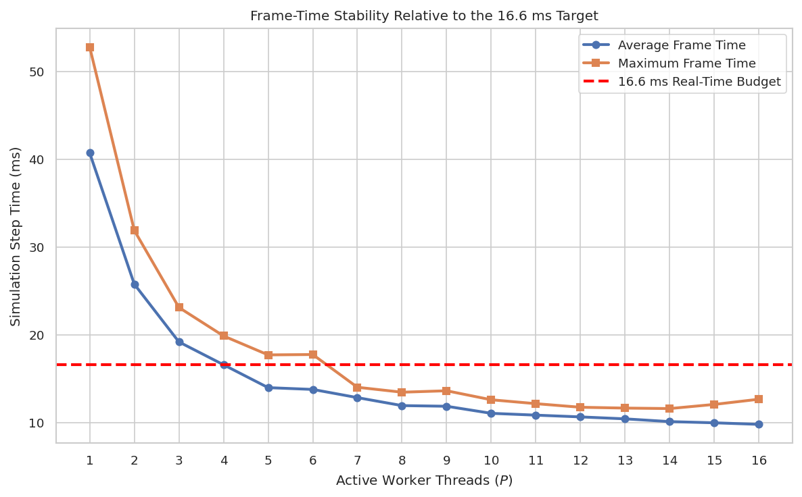</td>
  </tr>
  <tr>
     <th><i>Figure 6</i></th>
  </tr>
</table>

Evaluating the Complex scenario (~3,017 bodies) against a 60 Hz (16.6 ms) simulation budget demonstrates the practical impact of parallel execution: 
* **1 worker:** ~40 ms (exceeds real-time budget).
* **4 workers:** ~16.6 ms (reaches real-time threshold).
* **14-16 workers:** <10 ms (well within real-time budget).
*Note: Measurements reflect the isolated physics sub-step duration rather than the complete application frame time.*

## Physics Pipeline Breakdown
<table align = "center"> 
  <tr>
	  <td>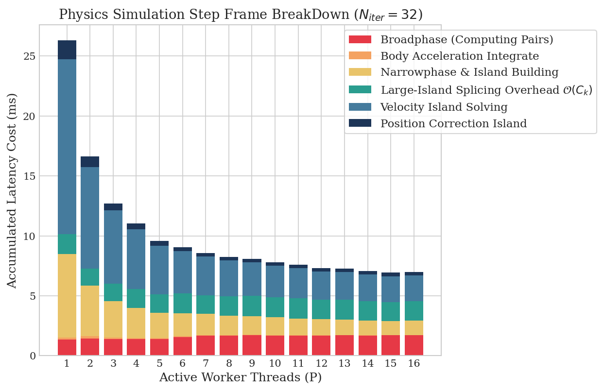</td>
  </tr>
  <tr>
     <th><i>Figure 7</i></th>
  </tr>
</table>

Dividing the physics sub-step into its principal execution stages at Niter = 32 illustrates how individual components respond to increasing worker count.
* **Body Acceleration Integration, Narrowphase & Island Building, Velocity Island Solving and Position Correction Solving:** Execution time decreases substantially as additional worker threads are introduced, accounting for the majority of the overall sub-step latency reduction. 
* **Broadphase & Large-island Splitting:** Both stages remain comparatively flat across all worker counts, forming a stable baseline cost as the parallel constraint-solving time shrinks.
## Island Decomposition and Workload Distribution
The following experiments investigate the effect of large-island decomposition on worker workload distribution and solver scalability. 
### Ranked Workload Distribution
<table align = "center"> 
  <tr>
      <td>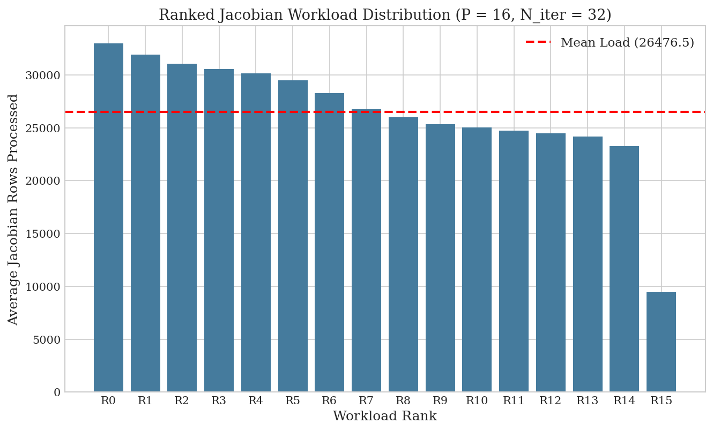</td>
	  <td>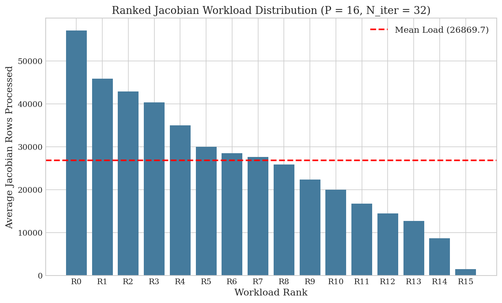</td>
  </tr>
  <tr>
     <th><i>Figure 8</i></th>
	 <th><i>Figure 9</i></th>
  </tr>
</table>

Ranking workers from highest workload (R0) to lowest (R15) on the Complex scene illustrates how large-island decomposition eliminated severe thread bottlenecks: 
* **With Decomposition:** Dominant islands are broken into independently schedulable batches, clustering worker loads tightly around the mean (~26,476.5 Jacobian rows).
* **Without Decomposition:** A single dominant island pins massive work onto one thread – with R0 processing **>55,000 Jacobian rows** while R15 processes close to zero.
### Load-Balancing Efficiency 
<table align = "center"> 
  <tr>
      <td>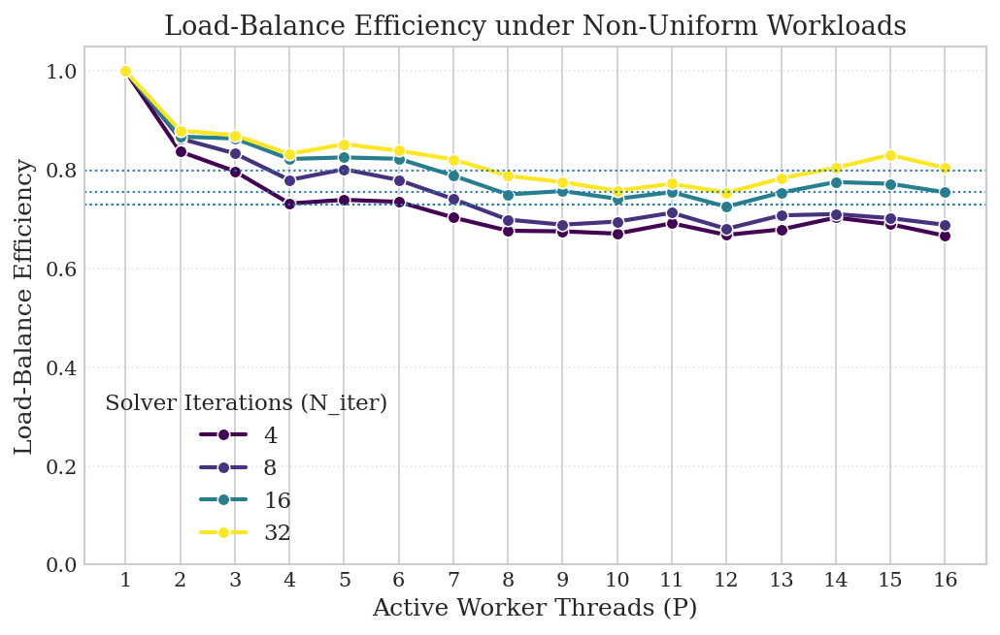</td>
	  <td>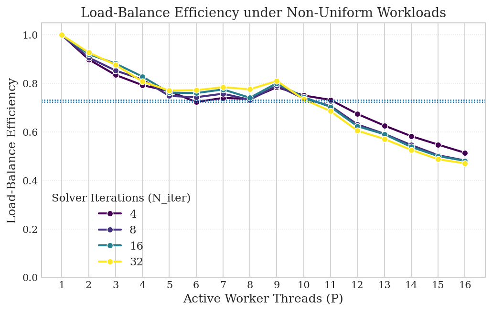</td>
  </tr>
  <tr>
     <th><i>Figure 10</i></th>
	 <th><i>Figure 11</i></th>
  </tr>
</table>

Load-balance efficiency $`∑J_i⁄((P×maxJ_i ) )`$, where $`J_i`$ is the Jacobian rows solved by worker I and P is the configured worker count. 1.0 = perfectly uniform distribution; lower values indicate idle workers or a dominant bottleneck worker.
* **With Decomposition:** At 16 workers, the 32-iteration workload maintains a load-balancing efficiency of ~0.8 (~0.75 for 4 iterations). 
* **Without Decomposition:** At 16 workers, load-balancing efficiency drops to ~0.5 across configurations due to work concentration on the highest-loaded thread

### Scaling Before and After Decomposition
<table align = "center"> 
  <tr>
	  <td>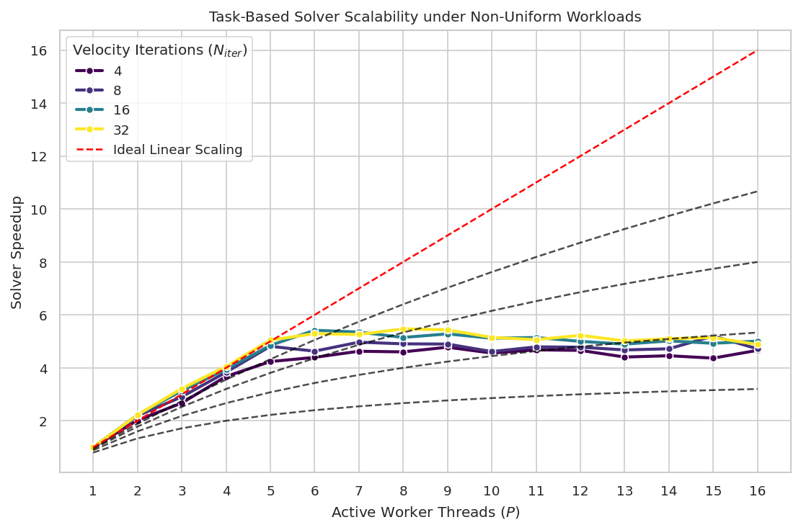</td>
  </tr>
  <tr>
	 <th><i>Figure 12</i></th>
  </tr>
</table>

At low worker counts the non-decomposed configuration scales well up to approximately five workers its measured speedup tracks the ideal reference slightly more closely than the decomposed configuration, which pays small batch-splitting overhead. 

Beyond approximately five workers the non-decomposed configuration plateaus: the largest island becomes a serial bottleneck and additional workers produce progressively smaller gains. The decomposed configuration continues exposing schedulable work independently past this point, maintaining improving scaling up to approximately twelve workers. 

## Comparison Between Ragdoll and Complex Workload
<table align = "center"> 
  <tr>
	  <td>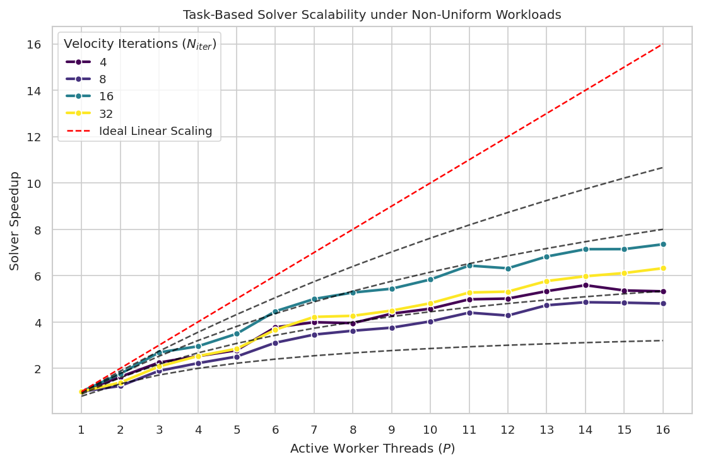</td>
  </tr>
  <tr>
     <th><i>Figure 13</i></th>
  </tr>
</table>

The Ragdoll scenario provides many independent islands, while the Complex scenario provides a more heterogeneous distribution dominated by fewer, larger islands. 

Both workloads exhibit change scaling behaviour around the 8-physical-core boundary, but their trajectories differ: Ragdoll exhibits intermittent local regressions, with smaller dips emerging around 8 workers and further fluctuations around 11-12 workers, before speedup generally resumes. In contrast, Complex maintains a more consistent upward trajectory across worker counts, although individual configurations exhibit brief plateaus and diminishing gains, particularly beyond 11-12 workers. 
# Scaling Behaviour
* **Workload Structure Determines Available Parallelism:** Aggregate body or constraint count alone does not determine scalability. A scene with many independent islands naturally exposes coarse-grained parallelism, whereas a scene dominated by a few large, connected islands restricts concurrency unless decomposed. 
* **Hierarchical Scheduling Granularity:** Island-level scheduling provides optimal parallelism when sufficient independent islands are available. When a dominant island becomes a bottleneck, large decomposition exposes smaller constraint batches as independently schedulable work. This allows multiple workers to participate in solving an island that would otherwise remain concentrated on a single worker. Decomposition therefore increases the available scheduling granularity rather than simply increasing worker capacity. 
* **Diminishing returns beyond physical cores:** Speedup stays below ideal linear scaling due to serial pipeline stages, scheduling/synchronisation overhead, and residual imbalance. Single-threaded stages (broad-phase, island preprocessing) bound end-to-end sub-step speedup regardless of worker count.
# Known Limitations
This evaluation focuses on computational throughput, workload distribution and real-time sub-step budgets for task-based velocity constraint solving.  All results are specific to the tested Vortrix build (MSVC, Development configuration), simulation scenarios, and hardware (AMD Ryzen 7 6800H).
* **Numerical Stability Not Evaluated:** The benchmarks measure execution time and scheduling behaviour rather than physics accuracy, constraint drift, or determinism across varying thread counts.
* **Remaining Serial Stages:** Broad-phase collision detection, island finalisation and decomposition, island warm starting and position correction remain single-threaded or do not yet utilise decomposed island batches, bounding end-to-end sub-step speedup. 
* **Hardware & Thread utilisation Constraint:** Scaling behaviour shifts around the 8-physical-core boundary of the AMD Ryzen 7 6800H, with logical SMT processors providing diminishing returns. Additionally, worker participation is intermittent; the configured worker count reflects maximum available concurrency rather than continuous utilisation across the entire physics sub-step. 
